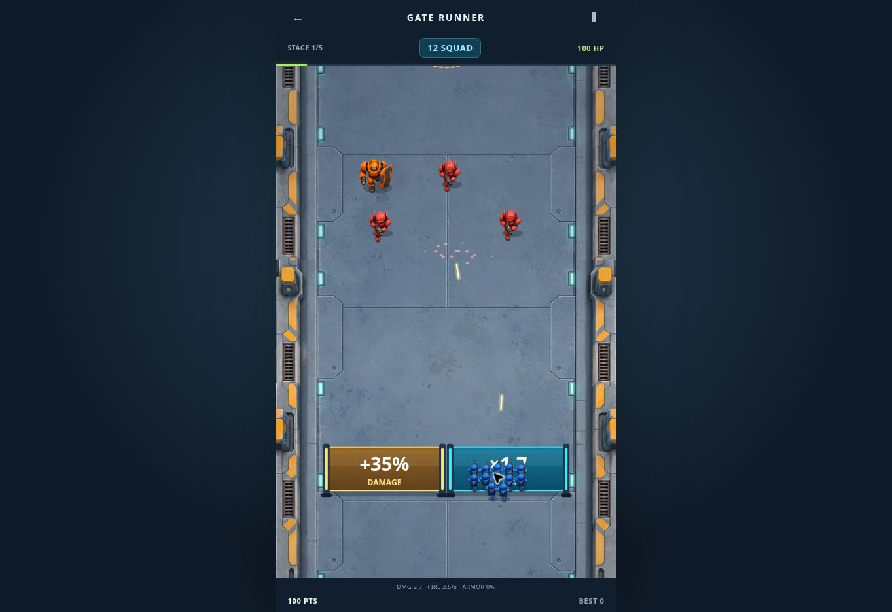

# Gate Runner visual assets

Created with the built-in image generation tool, then encoded as WebP for delivery. The character atlas preserves alpha. Total image payload is approximately 390 KiB. Both assets are included in the PWA precache.

- `public/assets/gate-runner/units.webp`: blue squad, coral infantry, orange shield, purple boss. Normalized source rectangles in `render.ts` isolate each sprite; sniper/spawner variants use tinting, and runners/bombers have badges.
- `public/assets/gate-runner/causeway.webp`: industrial road and water-edge environment, scrolled in world coordinates.

The renderer adds running bob, contact shadows, impact particles, hit flashes, projectile trails, dimensional glass gates, blinking mines, telegraph lines, and a boss health bar. Reduced-motion preferences disable sprite bob, particles, and damage flashes. Physics and balance are unchanged. Pointer mapping follows the revised camera scale.

## Generation prompts

### Character atlas

Use case: stylized-concept. Production asset: transparent game sprite atlas for a polished top-down arcade army runner. Create ONE square 1024x1024 PNG with a precise 2x2 grid of four isolated characters, each centered within its own 512x512 cell with generous empty padding, no grid lines. Top left: friendly cobalt-blue armored toy soldier seen from above and slightly behind, facing UP, helmet, compact rifle pointing up. Top right: coral-red hostile toy robot infantry facing DOWN, visor and stubby gun. Bottom left: heavy orange armored enemy robot with a large angular shield facing DOWN. Bottom right: large plum-purple boss mech facing DOWN with two cannon arms and bright orange reactor. Charming premium 3D mobile-game art, chunky rounded shapes, clean bevels, soft ambient occlusion, crisp readable silhouettes, restrained glossy highlights, consistent orthographic 3/4 overhead camera. Each character fully visible within its cell, no overlap, no ground plane, genuinely transparent background, no lettering, no numbers, no UI. Each figure should occupy about 70 percent of its cell. This is a usable sprite sheet, not a mockup.

### Terrain

Use case: stylized-concept. Production game background for a top-down arcade robot squad runner. Portrait 1024x1536. A straight vertical futuristic industrial causeway, orthographic overhead camera, parallel sides, NO perspective convergence, no horizon. The central 78 percent is smooth desaturated blue-gray concrete road with subtle large panel seams, restrained surface wear and tiny inset cyan guide lights near its edges, absolutely unobstructed. Narrow raised safety curbs with amber markings at both sides. Beyond the curbs, rich teal deep water and a few chunky industrial pipes and dock details confined to the outermost 8 percent edges. Premium stylized 3D mobile game diorama aesthetic, soft daylight, clean beveled geometry, delicate material texture, strong clear playfield, cohesive with blue armored toy soldiers and coral robot enemies. No units, no gates, no text, no UI, no logos. Low contrast middle ensures colorful sprites and gates read clearly. Road must extend all the way through top and bottom edges with matching colors for vertical looping. Flat overhead reusable game terrain texture, not a promotional scene.

The generator returned a 1254px-square atlas and 1024×1536 terrain; the renderer uses normalized source rectangles, not assumed 512px cells. The terrain is delivered at 768×1152. Generated texture matching is approximate at the vertical tile boundary.

## Deployed visual check

Cloudflare deployed `3759474` successfully. Checked the start screen and live gameplay in the cloud browser, including sprite/terrain loading, framed gate labels, pointer steering with the revised camera scale, aimed projectiles, hit particles, and score updates. The production build and 12 engine regression tests passed. Mobile device emulation remains unavailable in this browser.

