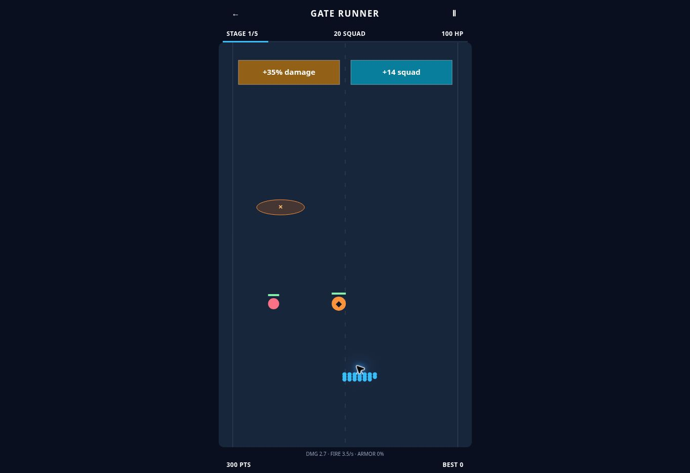

# Gate Runner gameplay review

## Findings and changes

Reviewed PR #12's Cloudflare preview and the engine at `42ee488`.

- The opening screen said only “Drag to steer” despite supporting keyboard input. Added the arrow-key hint, accessible pause/resume names, keyboard focus on overlays, and visible focus rings.
- Gate upgrades hid their magnitude, and standing in the middle missed both gates. Gates now show exact effects and split the whole road into two choices. Procedural side swaps prevent memorizing a fixed left/right route. Sacrifice gates explicitly show both the troop cost and damage gain.
- `lastStand` had no effect; `interest` increased an unspendable currency. Replaced both with a functional healing choice and removed the dead currency. Upgrade cards explain their effect; a compact build strip shows damage, fire rate, armor, and piercing.
- Target selection did not aim bullets at the target. Shots now have velocities toward their selected enemy and swept collision checks. Piercing shots track enemy IDs so one projectile cannot repeatedly damage one target.
- The fixed-step loop could continue after stage completion and award the completion bonus multiple times. It now stops at the transition, rejects invalid deltas, and does not advance non-playing states.
- Enemy archetypes were mostly colors and HP differences. Runners advance, shields resist non-piercing bullets, bombers pursue, snipers lock aim before firing, and spawners produce at most two runners. Escaped enemies cost HP, so avoiding every fight is not free.
- Added clearly marked mines and a moving boss with aimed, telegraphed spread shots. Scrolling stops at the boss; killing it is required to finish. Stage scaling increases boss pressure without making early waves unreadable.
- Initial runs always used seed 12345 and only failure changed the seed. New runs now randomize, retry preserves the seed, daily uses the UTC date, and `?seed=123` supports reproducible runs. Daily and ordinary runs use the same rules and high-score category; no backend leaderboard is implied.
- Pointer handling now tracks the active pointer rather than depending on mouse button flags. It handles cancellation and ignores secondary touches. Pointer and keyboard steering share a movement-speed limit. Blur/visibility loss pauses and clears held keys.
- Removed the 400px minimum screen height, added short-height styling and safe-area spacing, and retained 44px primary controls.

## Simulation method

Run `SEEDS=300 npm run simulate:gate-runner -- --write` to reproduce the checked-in JSON. Six policies run seeds 1–300 (1,800 full attempts), at 60 fixed steps per second. Each run is limited to six simulated minutes and checks finite state and army/health bounds.

Idle remains in the center, random picks new directions every 200ms, and the three active policies prioritize squad, damage, or a balanced troop threshold. Active policies project observed projectile velocities, avoid nearby mines/enemies, and choose only offered upgrades. They use engine state and are an upper bound on play, not a human study. Even the reactive variant (400ms decisions, 15% dropped inputs, steering error) retains exact threat information; its success rate must not be called a human win rate. All policies make upgrade selections; “idle” means no steering, not no interaction at all.

| Policy | Clears / 300 | Mean stage | Mean run time | Mean score |
| --- | ---: | ---: | ---: | ---: |
| Idle steering | 10 | 2.1 | 59.3s | 4,125.6 |
| Random steering | 101 | 3.1 | 94.4s | 8,602.3 |
| Squad | 300 | 5.0 | 195.7s | 21,163.4 |
| Damage | 299 | 5.0 | 155.4s | 16,992.5 |
| Balanced | 300 | 5.0 | 155.0s | 18,299.2 |
| Reactive | 300 | 5.0 | 155.2s | 18,137.1 |

The initial revised balance allowed 93/100 idle clears. Increasing boss durability and attack pressure lowered passive success while retaining multiple viable strategies. Squad builds earn more survivor points but take longer; damage builds clear faster. The simulator currently chooses upgrades greedily and does not exhaust all build combinations. Five finite stages, seed changes, daily runs, retry, and build decisions supply replayability; this is not an endless campaign or a permanent progression economy.

## Verification

- Production TypeScript/Vite/PWA build passed. Existing unrelated large-chunk warnings remain.
- 12 engine tests passed, including 1,000 generated level checks, terminal score idempotence, invalid input, gate-center behavior, piercing, aiming, collision/breach accounting, boss gating, telegraphing, offered upgrades, and 30/60 FPS equivalence.
- 13 Breakout and 34 Cube Lines regression tests passed. Cube Lines used `node --import tsx --test src/games/cube-lines/*.test.ts` because the tsx CLI IPC socket is unavailable in this environment.
- Cloud-browser observations and any remaining device limitations are recorded below after deployment validation.

### Cloud browser validation

Cloudflare check for `e7f8a6f` succeeded; reviewed the immutable deployment at https://25fcbf2b.brainrot-games-2eg.pages.dev/games/gate-runner/ . The branch preview initially kept its previous service-worker-cached version after a reload, so the deployment-specific origin was used to avoid confusing old assets with this revision.

Observed the new start overlay and focused Run control; selected Daily run and confirmed seed 20261024. Ran the game, dragged across both lanes, collected the ×1.7 gate (12 → 20 soldiers), watched aimed firing and kill score increases (0 → 100 → 300), and verified Escape pause, Resume, and the accessible pause label transition. The desktop shell measured 500 × 936 CSS pixels with a 500 × 801 canvas and a 44 × 44 pause target. Browser logs inspected contained extension metadata errors, not a game-origin exception.

The cloud-browser API available for this review has no viewport resize or touch-device emulation method. Native touch, multi-touch, iOS Safari, and narrow portrait/landscape rendering remain **unverified**. Pointer drags exercise the shared steering path but are not a substitute for that device testing. Mobile improvements above are source-reviewed. Full five-stage outcomes, upgrade effects, game-over and replay determinism were exercised by engine tests/simulations; manual browser play covered the opening stage, not a complete campaign. Do not claim a full mobile or end-to-end human playtest from these results.

